# About the project

Virtual Transcription Laboratory is a tool that allows you to create digital text based on scans.
The tool allows the transcription of objects imported from Digital Libraries, also using the IIIF standard.
Transcription can be performed automatically using Tesseract or Kraken.
The results of automatic OCR can be improved manually and later used to train better OCR models.
Final transcription can be used to prepare a digital object in standards such as: hOCR, TEI, PDF, eBook.

# Repository contents

The repository contains the following modules:
- [portal-bl](./portal-bl/) - the main back-end of the application (Java Spring Boot)
- [portal-ui](./portal-ui/) - the front-end of the application (React)
- [iiif-tools](./iiif-tools/) - the component for processing scan files and preparing IIIF contents (Java Spring Boot)
- [iiif-server](./portal-bl/etc/iiif-server/) - the container for serving IIIF contents (IIPImage server)
- [ocr-tools](./ocr-tools/) - the component for invoking OCR engines (Java Spring Boot)
- [ocr-training](./ocr-training/) - tools for training OCR models (Java Spring Boot)
- [postgresql](./postgresql/) - the container for the database (PostgreSQL)
- [docs](./docs/) - documentation resources

# Architecture overview

